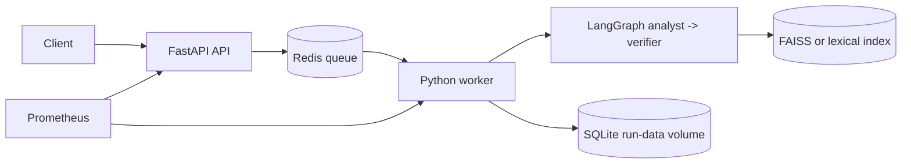

# Architecture and implementation status

The API validates and quarantines before publishing a Redis job. The worker consumes the job, reconstructs the validated Pydantic petition, runs the bounded LangGraph workflow, verifies citations and writes a terminal SQLite result. Prometheus scrapes API and worker metrics. The semantic index is a versioned local artifact; the default image uses the synthetic lexical index unless semantic dependencies and model weights are explicitly supplied.

The explicit hand-off is Analyst -> Research and Verification Agent. Tool calls are selected by the research worker, bounded by graph policy, and every citation must resolve to a passage returned for the same run. Committee discretion produces escalation, not a fabricated grant.
