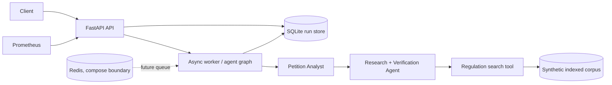

# Architecture and implementation status

The explicit hand-off is Analyst -> Research + Verification Agent. Tool calls are selected by the research worker, bounded by the graph policy, and every citation must resolve to a passage returned for the same run. Committee discretion produces escalation, not a fabricated grant.

